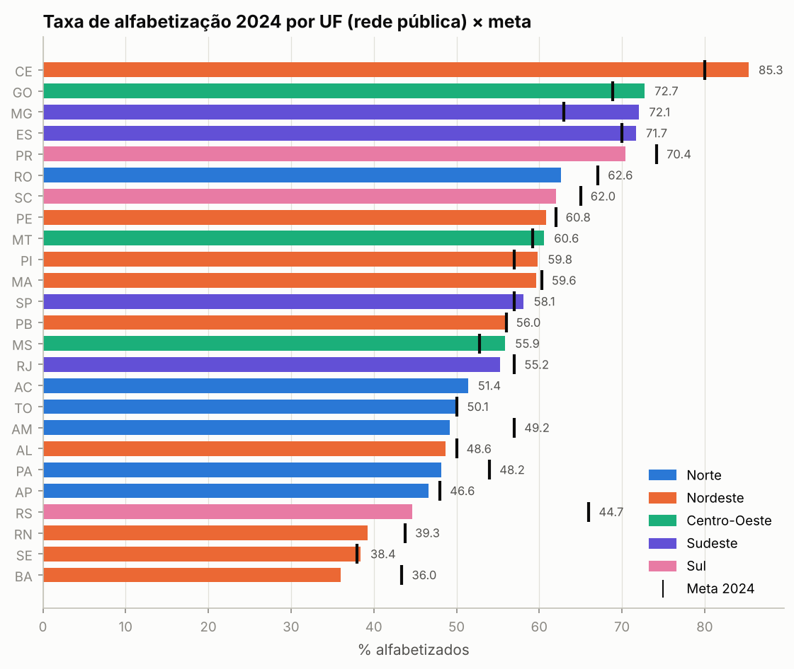
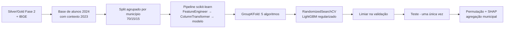
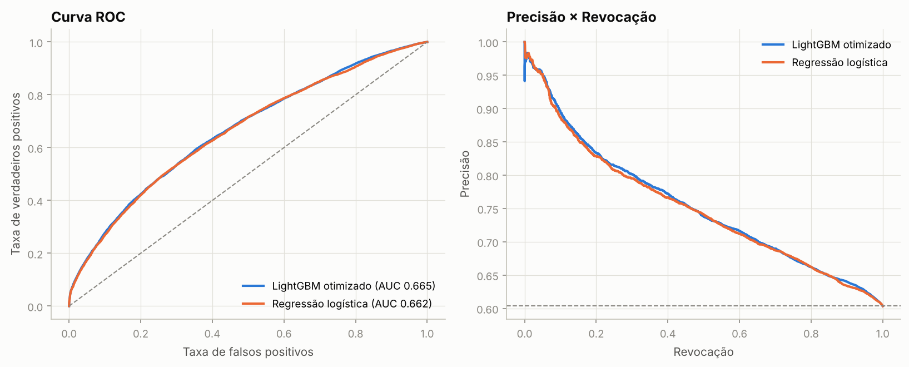
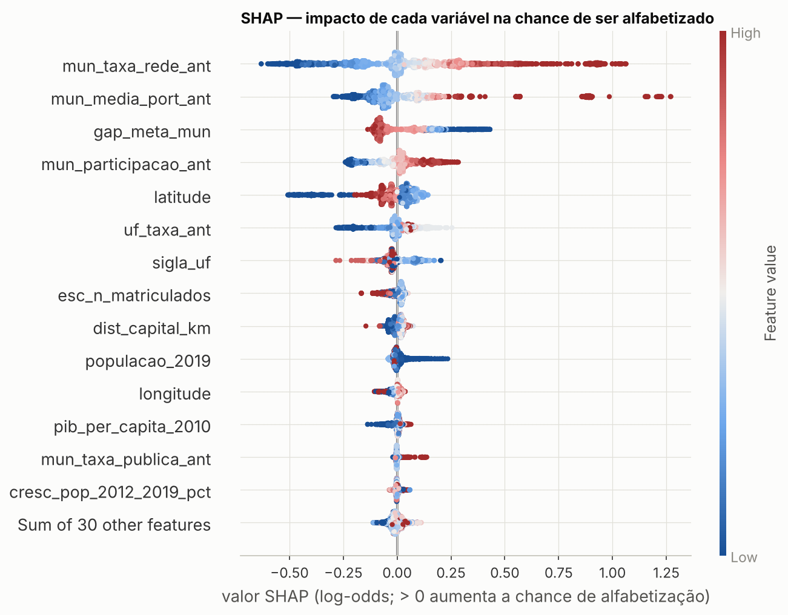
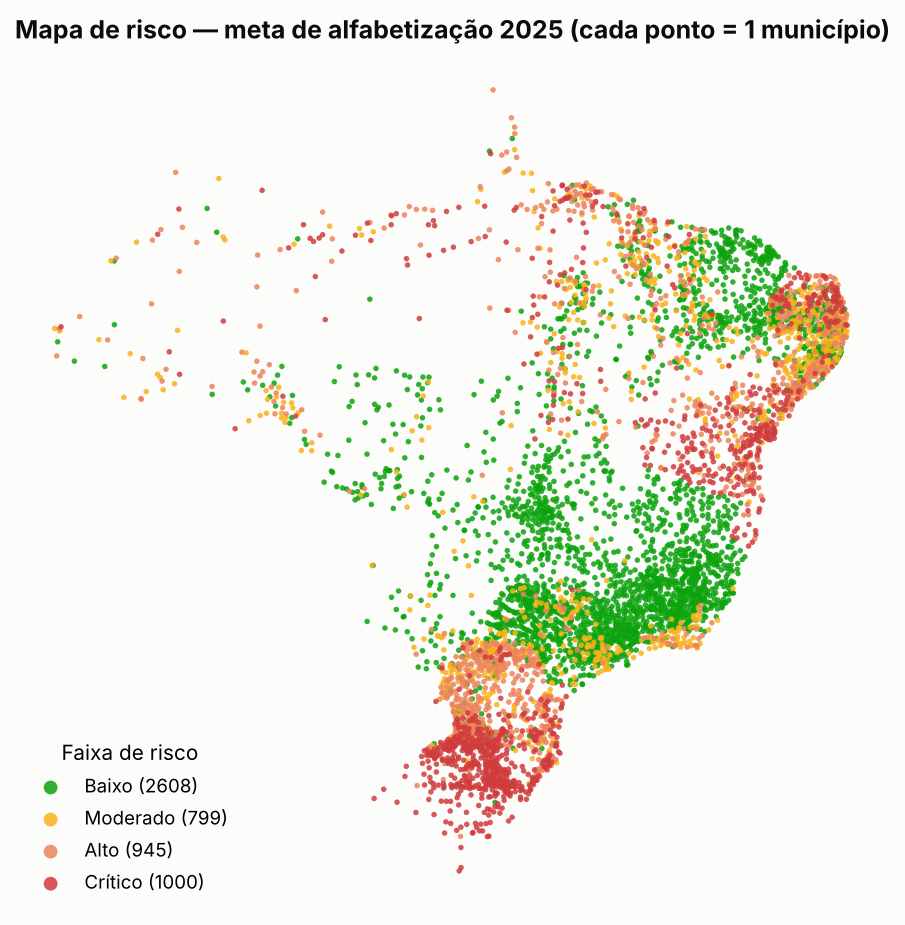

# Predição e Inteligência Analítica para Alfabetização no Brasil

**Tech Challenge — Fase 3 · POSTECH FIAP (1IAST)**

> 🎬 **Vídeo executivo:** _link a inserir após a gravação_ · 📋 **Checklist de entrega:** [`docs/entrega.md`](docs/entrega.md)

Modelos de Machine Learning sobre a camada Gold do **Indicador Criança Alfabetizada** para prever se um aluno será
alfabetizado, identificar os municípios com maior risco de não atingir as metas e agrupar territórios com padrões semelhantes.

> **Fase anterior (fonte dos dados):** pipeline de engenharia de dados da Fase 2 —
> **[postechfiap018-ctrl/TECH_CHALLENGE_FASE2_PIPELINE](https://github.com/postechfiap018-ctrl/TECH_CHALLENGE_FASE2_PIPELINE)**
> (BigQuery/Base dos Dados → S3 Bronze → Glue Silver/Gold → Athena). Esta Fase 3 consome as camadas Silver/Gold produzidas por ela
> (§ 3 explica a integração).

## Integrantes

| Nome | RM |
|---|---|
| Leandro Tanihira | _RM_ |
| _Integrante 2_ | _RM_ |
| _Integrante 3_ | _RM_ |
| _Integrante 4_ | _RM_ |
| _Integrante 5_ | _RM_ |

---

## Sumário
1. [Contexto do problema](#1-contexto-do-problema)
2. [Objetivo analítico](#2-objetivo-analítico)
3. [Base utilizada e integração com a Fase 2](#3-base-utilizada-e-integração-com-a-fase-2)
4. [Análise exploratória e hipóteses](#4-análise-exploratória-e-hipóteses)
5. [Etapas de modelagem](#5-etapas-de-modelagem)
6. [Escolha do algoritmo](#6-escolha-do-algoritmo)
7. [Métricas de avaliação](#7-métricas-de-avaliação)
8. [Interpretação dos resultados](#8-interpretação-dos-resultados)
9. [Insights e respostas às perguntas de negócio](#9-insights-e-respostas-às-perguntas-de-negócio)
10. [Limitações](#10-limitações)
11. [Aplicação prática para políticas públicas](#11-aplicação-prática-para-políticas-públicas)
12. [Evoluções futuras](#12-evoluções-futuras)
13. [Estrutura do repositório e como executar](#13-estrutura-do-repositório-e-como-executar)
14. [Versionamento e colaboração](#14-versionamento-e-colaboração)

---

## 1. Contexto do problema

O **Compromisso Nacional Criança Alfabetizada** estabelece que toda criança deve estar alfabetizada ao fim do 2º ano do ensino
fundamental. O INEP considera alfabetizado o aluno com **proficiência ≥ 743 pontos** na escala Saeb, e o indicador é o percentual de
alunos acima desse corte. A meta nacional é **80% em 2030** — em 2024 o país estava em **59,2%** (rede pública).

Na Fase 2 construímos a pipeline que integra resultados, metas (Brasil, UF e município), território e microdados de alunos. Gestores
públicos, porém, precisam de mais do que a fotografia atual: precisam **antecipar riscos**, **localizar territórios vulneráveis** e
**entender quais fatores pesam mais** para direcionar recursos.

## 2. Objetivo analítico

| Meta de negócio | Meta analítica | Entregável |
|---|---|---|
| Antecipar quais crianças/escolas precisam de apoio | Classificador supervisionado: **o aluno será alfabetizado?** (alvo `alfabetizado`) | `models/modelo_alfabetizacao_lgbm.joblib` |
| Priorizar municípios | Probabilidade de **não atingir a meta do ano seguinte** + agregação das probabilidades de alunos | `reports/ranking_risco_municipios_2025.csv` |
| Desenhar políticas por perfil | Clusterização de perfis municipais | `reports/clusters_municipios.csv` |
| Explicar as decisões | Feature importance (ganho e permutação) + **SHAP** | notebook 03 |

## 3. Base utilizada e integração com a Fase 2

### 3.1 Camada analítica

| Tabela | Granularidade | Principais colunas |
|---|---|---|
| `indicador_municipio` | município × ano × rede | `taxa_alfabetizacao`, `media_portugues`, `meta_alfabetizacao_2024..2030`, gaps |
| `perfil_alunos_municipio` | município × ano × rede | participação, proficiência média, % acima de 743 (ponderados por `peso_aluno`) |
| `metas_vs_resultados_uf` | UF × ano | taxa e metas estaduais |
| `evolucao_temporal` | Brasil/UF × ano | série do indicador |
| `silver/alunos` | aluno (≈ 2,1 milhões em 2024) | `alfabetizado` (alvo), `rede`, `id_escola`, `presenca` … |
| **Enriquecimento externo (IBGE)** | município | população 2019 e crescimento 2012–2019, PIB per capita, latitude/longitude, capital, distância à capital |

As fontes externas do IBGE são baixadas de repositórios públicos ([kelvins/municipios-brasileiros](https://github.com/kelvins/municipios-brasileiros),
[rdsilva/BrazilPopulation](https://github.com/rdsilva/BrazilPopulation)) por `src/preprocessing/external.py` — 99,5% dos municípios casados.

### 3.2 Como a Fase 3 lê o data lake da Fase 2

O [repositório da Fase 2](https://github.com/postechfiap018-ctrl/TECH_CHALLENGE_FASE2_PIPELINE) publica no S3:
`silver/resultado_municipio`, `silver/resultado_uf`, `silver/metas_*` (formato longo), `silver/alunos` e
`gold/indicador_por_municipio`, `gold/comparacao_metas_resultados`, `gold/evolucao_temporal_indicador`.

`src/preprocessing/fase2_adapter.py` converte esse layout oficial na camada analítica acima (decodifica `rede`, re-pivota as metas,
agrega os microdados) e **valida o resultado contra `gold/comparacao_metas_resultados`** (diferença máxima de taxa e meta = 0).
O layout é detectado automaticamente (`src/config.py`):

| Ordem | Origem do data lake | Como configurar |
|---|---|---|
| 1 | Caminho ou bucket explícito | `FASE2_DATALAKE=s3://<bucket>` ou `FASE2_DATALAKE=<pasta>` |
| 2 | Bucket da Fase 2 | `DATALAKE_BUCKET=<bucket>` (mesma variável do repositório da Fase 2; credenciais AWS padrão) |
| 3 | Cópia local do bucket | `aws s3 sync s3://<bucket>/silver data/fase2_oficial/silver` (idem para `gold`) |
| 4 | Execução local da pipeline | pasta irmã `../Desafio - Fase 2/datalake` |

### 3.3 De onde veio a base completa de alunos

O extrator AWS da Fase 2 usa `TABLESAMPLE SYSTEM (2 PERCENT)` para `alunos` (`QUERY_OVERRIDES` em `src/config.py` daquele
repositório): a Silver publicada no S3 tem só ~2% dos microdados, suficiente para a Gold agregada da Fase 2, mas não para modelar alunos.

Por isso, **os resultados desta entrega foram gerados com a tabela completa**, processada pela **mesma arquitetura medalhão da Fase 2
(Bronze → Silver → Gold), executada localmente**:

| Etapa | Detalhe |
|---|---|
| Fonte | tabela `br_inep_avaliacao_alfabetizacao.alunos` da Base dos Dados, exportada **sem amostragem** (3.868.000 registros: 1.747.439 em 2023 e 2.120.560 em 2024), junto com `municipio`, `uf` e as três tabelas de metas |
| Bronze → Silver | mesmas regras da Fase 2: deduplicação por `ano + id_aluno`, `id_municipio` com 7 dígitos, `rede` decodificada, `sigla_uf` derivada do código IBGE, proficiência nula para ausentes |
| Silver → Gold | tabelas analíticas da §3.1, com quality gate antes da Gold |

**Equivalência com o caminho AWS:** `tests/test_fase2_adapter.py` recria o layout oficial (Silver/Gold da pipeline Glue) a partir desses
mesmos CSVs, e o adaptador reproduz a `gold/comparacao_metas_resultados` com diferença zero. A base de modelagem gerada pelos dois
caminhos é **idêntica** (1.852.788 alunos, mesmas features). Para rodar 100% pela AWS, basta remover o override de `alunos` no
extrator da Fase 2 e reexecutar Bronze → Silver. O adaptador avisa se detectar a amostra de 2%.

### 3.4 Sem acesso ao data lake? Modo amostra

O repositório versiona uma **amostra do data lake** em [`data/amostra/`](data/amostra/README.md): Gold completa mais todos os alunos de
555 municípios sorteados (10% por UF), cerca de 7 MB. Quando nenhum data lake é encontrado, a pipeline e os notebooks usam essa amostra
automaticamente (ou com `FASE3_AMOSTRA=1`). As saídas vão para `outputs_amostra/`, sem sobrescrever os resultados oficiais. Com a amostra
o fluxo é idêntico, mas as métricas do modelo de alunos ficam um pouco menores (AUC ≈ 0,62), porque há menos municípios para treinar e testar.

## 4. Análise exploratória e hipóteses

Notebook [`01_analise_exploratoria.ipynb`](notebooks/01_analise_exploratoria.ipynb).



| Hipótese | Resultado |
|---|---|
| **H1** Histórico territorial prediz o resultado | ✔ alunos de municípios do pior quintil de 2023: **43%** alfabetizados; do melhor: **77%** |
| **H2** Desigualdade regional (Norte/Nordeste abaixo) | ✔ — com a exceção notável do **Ceará (85%)**, 1º do país |
| **H3** Municípios mais ricos alfabetizam mais | ✘ relação fraca e não monotônica — gestão pesa mais que renda |
| **H4** Municípios pequenos não ficam atrás | ✔ municípios até 10 mil hab. lideram (66%) |
| **H5** Engajamento (participação na avaliação) | ✔ 48% → 71% entre quintis de participação |
| **H6** Choque regional em 2024 | ✔ Sul caiu (mediana −5,8 p.p.), concentrado no RS — compatível com as enchentes de maio/2024 |

Também observamos forte **regressão à média** (municípios do pior quintil sobem +8,7 p.p.; do melhor caem −4,7 p.p.).

**Achados de qualidade que mudaram a modelagem:** alunos ausentes têm `alfabetizado = 0` sem terem feito a prova (alvo falso → excluídos);
`proficiencia` define o alvo com 100% de concordância (vazamento direto → removida).

## 5. Etapas de modelagem

Notebook [`02_modelagem_supervisionada.ipynb`](notebooks/02_modelagem_supervisionada.ipynb) · código em `src/`.



**Desenho temporal e tratamento de *data leakage***

| Risco | Tratamento |
|---|---|
| `proficiencia` define o alvo | removida |
| `presenca`, `preenchimento_caderno`, `peso_aluno` (pós-prova) | removidas (presença só como filtro) |
| Taxas da escola/município **do mesmo ano** contêm o próprio aluno | features de contexto sempre de **T-1 (2023)**; alvo em **T (2024)** |
| Alunos do mesmo município em treino e teste | `GroupShuffleSplit`/`GroupKFold` por `id_municipio` (asserts no código) |
| Estatísticas de imputação/escala calculadas com dados de teste | todo o pré-processamento dentro do `Pipeline` (ajustado só no treino de cada fold) |
| Limiar escolhido olhando o teste | limiar escolhido na **validação** |

**Pipeline (`src/modeling/pipelines.py`)**

| Etapa | Numéricas | Categóricas |
|---|---|---|
| `FeatureEngineer` | escola × município (T-1), gap até a meta, flag "escola sem histórico", logs de população/PIB/matrícula | — |
| Imputação | mediana + **indicador de ausência** | moda |
| Transformação | `StandardScaler` (lineares) | `OneHotEncoder` (lineares) · `OrdinalEncoder` (árvores) |
| Modelo | Logística · Random Forest · HistGradientBoosting · LightGBM | |

Features: contexto da escola e do município em 2023, participação, metas (definidas a priori), contexto estadual, rede, UF/região, porte e
variáveis do IBGE — 23 variáveis de entrada → 29 após a engenharia de atributos.

## 6. Escolha do algoritmo

| Modelo (GroupKFold, 5 folds, 200 mil alunos) | AUC CV | Gap treino−CV |
|---|---|---|
| Random Forest | 0,665 ± 0,008 | 0,033 |
| Regressão logística | 0,664 ± 0,009 | 0,003 |
| HistGradientBoosting | 0,661 ± 0,009 | 0,061 |
| LightGBM (padrão) | 0,661 ± 0,009 | 0,075 |
| **LightGBM otimizado** (RandomizedSearchCV, 20 configs, GroupKFold) | **0,666** | **0,025** |

O **LightGBM regularizado** (`min_child_samples=280`, `reg_alpha≈2,8`, `reg_lambda≈3,5`, `learning_rate≈0,023`, 240 árvores) foi escolhido:
melhor AUC após a otimização, gap de overfitting 3× menor que o padrão, treino rápido e compatível com SHAP exato (TreeExplainer). A
regressão logística fica a ≈ 0,003 de AUC e é mantida como *baseline* interpretável.

Para o **risco municipal** escolhemos a **regressão logística**, mesmo com AUC menor que a Random Forest na CV estratificada (0,763 × 0,787):
na **CV agrupada por UF** a logística mantém 0,707 e a floresta cai para 0,621 — a floresta "decora" padrões estaduais. Robustez e
transparência pesaram mais.

## 7. Métricas de avaliação

**Modelo de alunos (LightGBM, limiar 0,54 escolhido na validação)**

| Conjunto | ROC-AUC | PR-AUC | Acurácia balanceada | Recall "não alfabetizado" | Brier |
|---|---|---|---|---|---|
| Treino | 0,681 | 0,756 | 0,621 | 0,503 | 0,218 |
| Validação | 0,639 | 0,727 | 0,590 | 0,422 | 0,225 |
| **Teste** (243.822 alunos, 828 municípios nunca vistos) | **0,665** | **0,754** | **0,607** | **0,500** | **0,220** |
| Teste — regressão logística | 0,662 | 0,751 | 0,592 | 0,390 | 0,221 |

* Estabilidade: desvio da AUC entre sementes = 0,0005; entre folds < 0,01. Probabilidades bem **calibradas**.
* **Validação (0,639) abaixo do teste (0,665):** validação e teste são conjuntos **diferentes de municípios** (828 cada), sorteados por
  grupo. A diferença reflete a heterogeneidade entre grupos de municípios, não sobreajuste. Na CV agrupada (5 folds de municípios), a AUC
  varia ±0,009 em torno de 0,666; o limiar foi escolhido na validação e o teste foi usado uma única vez, sem ajuste posterior.
* **Agregado por município** (753 municípios de teste com ≥ 30 alunos): correlação **0,81** com a taxa real 2024, erro médio **8,0 p.p.**,
  viés ≈ 0 — **29% menos erro** que a regra "repetir a taxa do ano anterior" (11,4 p.p.).

**Modelo de risco municipal (logística)** — ROC-AUC 0,763 (CV estratificada) · 0,707 (CV por UF) · acurácia balanceada 0,69.



## 8. Interpretação dos resultados

Notebook [`03_interpretabilidade.ipynb`](notebooks/03_interpretabilidade.ipynb).



| Tema (permutação no teste) | % da importância |
|---|---|
| Histórico do município (taxa e proficiência 2023) | 72% |
| Território e socioeconomia (IBGE) | 10% |
| Contexto estadual | 8% |
| Engajamento (participação 2023) | 5% |
| Metas pactuadas | 3% |
| Histórico da escola (2023) | < 1% |

* **Histórico municipal domina**; a escola isolada quase não acrescenta (turmas pequenas, correlação 2023→2024 de 0,26) → o sinal está
  no **sistema de ensino**, não na escola.
* **Participação alta** aumenta consistentemente a chance (SHAP) — fator **acionável**.
* **PIB per capita e porte** pesam pouco depois que o histórico é conhecido.
* Explicações locais (waterfall SHAP) mostram **por que** um aluno/escola foi priorizado — essencial para transparência.

## 9. Insights e respostas às perguntas de negócio

Notebook [`04_aplicacao_estrategica.ipynb`](notebooks/04_aplicacao_estrategica.ipynb).

| Pergunta | Resposta |
|---|---|
| **Quais fatores mais impactam a alfabetização?** | Histórico recente da rede municipal, contexto estadual e engajamento na avaliação. Renda média tem papel secundário — **gestão educacional explica mais que riqueza** (Ceará como prova). |
| **Quais municípios têm maior risco?** | 1.000 municípios em risco **crítico** e 945 em risco **alto** de não atingir a meta 2025 — concentrados no Sul (RS em especial), Norte e parte do Nordeste (BA, RN, MA, PB). Lista completa e priorizável em `reports/ranking_risco_municipios_2025.csv`. |
| **Quais regiões têm padrões semelhantes?** | 4 perfis (K-Means): **A · Vulnerável** (41%, em queda), **B · Urbano mediano** (57%, baixa participação), **C · Interior intermediário** (68%, estagnado), **D · Referência** (82%, +11,6 p.p.). Os perfis **cruzam fronteiras regionais** — 35% dos municípios do Nordeste são *Referência*. |
| **Como prever quem não atingirá metas futuras?** | Classificador treinado com contexto T → resultado T+1, re-treinado a cada ciclo + análise de trajetória: **2.050 municípios (38%) estão estagnados ou em queda** e outros 533 crescem abaixo do ritmo necessário para 80% em 2030. |
| **Quais variáveis mais influenciam os modelos?** | `mun_taxa_rede_ant`, `mun_media_port_ant`, `gap_meta_mun`, `mun_participacao_ant`, latitude/UF (SHAP e permutação concordam). |



## 10. Limitações

* **Teto de informação no nível do aluno** (AUC ≈ 0,66): faltam variáveis individuais (família, frequência, professor). O modelo mede **risco
  contextual** e **não deve ser usado para rotular crianças**.
* **Apenas dois ciclos** (2023 e 2024): o modelo de risco foi treinado com uma única transição, marcada pelo choque das enchentes do RS — parte
  do risco atribuído ao Sul é um efeito regional desse ano. 2025 na Fase 2 vem de **streaming simulado** e não foi usado como alvo.
* **Microdados 2023 ausentes** para SP, DF, AC e RR (tratado com imputação + indicador de ausência).
* Variáveis externas desatualizadas (PIB 2010, população 2019); Censo Escolar, FUNDEB, CadÚnico e IDHM não foram integrados por
  indisponibilidade de acesso automatizado nesta entrega.
* Correlação ≠ causalidade: importâncias e SHAP descrevem o modelo, não efeitos causais de política.
* A silhueta dos clusters é baixa (≈ 0,17): perfis municipais formam um contínuo; os grupos são uma simplificação útil para gestão.

## 11. Aplicação prática para políticas públicas

1. **Focalização da assistência técnica** — priorizar os municípios *Crítico/Alto* (ordenados por probabilidade e número de crianças)
   para formação de alfabetizadores, material estruturado e avaliação formativa.
2. **Plano de recomposição no RS** — recuperação de aprendizagem e revisão pactuada da trajetória de metas pós-desastre.
3. **Metas de participação (≥ 90%)** — barato, acionável e associado a melhores resultados.
4. **Cooperação horizontal** — parear municípios *Referência* e *Vulnerável* de mesmo porte/UF (inspirado no PAIC do Ceará).
5. **Painel de monitoramento** — `reports/painel_gestores_municipios.csv` consolida risco, perfil e trajetória até 2030 para cada município;
   pode ser publicado no Athena/QuickSight da arquitetura da Fase 2.

## 12. Evoluções futuras

* Integrar **Censo Escolar** (infraestrutura, formação docente, tempo integral), **FUNDEB/VAAR**, **CadÚnico** e **IDHM**.
* Re-treinar com o ciclo 2025 do Saeb e validar o ranking de risco *out-of-time*.
* Modelos hierárquicos/multinível (aluno → escola → município) e séries temporais por UF até 2030.
* Implantação como job agendado na arquitetura da Fase 2 (Glue/SageMaker) com monitoramento de *drift* e de equidade por região.
* Painel interativo para secretarias municipais com explicações SHAP por município.

## 13. Estrutura do repositório e como executar

```
tech-challenge-fase3/
├── data/
│   ├── raw/            # fontes externas baixadas (IBGE) — geradas, não versionadas
│   ├── external/       # municipios_enriquecidos.csv (IBGE tratado)
│   ├── amostra/        # amostra versionada do data lake (Gold + alunos de 555 municípios)
│   ├── analytic/       # camada analítica derivada do lake oficial da Fase 2 (gerada)
│   └── processed/      # base de modelagem e predições (geradas)
├── notebooks/
│   ├── 01_analise_exploratoria.ipynb
│   ├── 02_modelagem_supervisionada.ipynb
│   ├── 03_interpretabilidade.ipynb
│   └── 04_aplicacao_estrategica.ipynb
├── src/
│   ├── config.py                 # caminhos, detecção do data lake da Fase 2, sementes
│   ├── main.py                   # orquestrador ponta a ponta
│   ├── preprocessing/            # leitura, adaptador da Fase 2, IBGE, features, transformers
│   ├── modeling/                 # pipelines, treino/CV/tuning, risco municipal e clusters
│   ├── evaluation/               # métricas, por subgrupo, permutação e SHAP
│   └── visualization/            # estilo e gráficos padronizados
├── tests/                        # testes da pipeline (dados sintéticos) + adaptador da Fase 2
├── .github/                      # CI (GitHub Actions), templates de PR e issue
├── scripts/                      # publicar_github.sh — cria o repositório e publica branches/PRs
├── models/                       # modelos .joblib + metadados .json
├── reports/                      # métricas, rankings, clusters, painel para gestores
├── images/                       # figuras usadas no README e nos notebooks
├── docs/                         # decisões analíticas e roteiro do vídeo
├── requirements.txt
└── README.md
```

```bash
python -m venv .venv && .venv\Scripts\activate        # Windows  (Linux/Mac: source .venv/bin/activate)
pip install -r requirements.txt

# Opção A — data lake oficial da Fase 2 (AWS)
set DATALAKE_BUCKET=tech-challenge-alfabetizacao-<sufixo>   # Linux/Mac: export ...
# Opção B — cópia local:  aws s3 sync s3://<bucket>/silver data/fase2_oficial/silver  (e gold)
# Opção C — pasta irmã "../Desafio - Fase 2/datalake" (detectada automaticamente)
# Opção D — nenhuma das anteriores: usa data/amostra/ automaticamente (saídas em outputs_amostra/)

python -m src.main            # pipeline completa (~40 min em 2 núcleos)  |  --fast para teste rápido
jupyter lab notebooks/        # ou execute os notebooks 01 → 04
pytest tests -q               # testes da pipeline; os do adaptador rodam se os CSVs da Base dos Dados estiverem disponíveis
```

Reprodutibilidade: semente fixa (`RANDOM_STATE=42`) em splits, CV, busca e modelos; versões mínimas em `requirements.txt`.

## 14. Versionamento e colaboração

Fluxo **Git Flow simplificado**, igual ao da Fase 2: `main` protegida + branches de feature integradas via **Pull Request** com revisão.

| Branch | Conteúdo |
|---|---|
| `feature/estrutura-projeto` | esqueleto, configuração, requirements |
| `feature/integracao-fase2` | leitura do lake da Fase 2, adaptador do layout oficial, testes |
| `feature/eda` | enriquecimento IBGE, notebook 01 |
| `feature/modelagem` | pipelines, CV, tuning, notebook 02 |
| `feature/interpretabilidade` | permutação, SHAP, notebook 03 |
| `feature/aplicacao-estrategica` | risco municipal, clusters, notebook 04 |
| `docs/readme-e-video` | README, decisões analíticas, roteiro do vídeo |
| `chore/estrutura-github` | CI, templates de PR/issue, CONTRIBUTING, testes da pipeline, checklist de entrega |

Todo PR passa pelo **CI** (GitHub Actions: instalação limpa em Python 3.10 e 3.12, testes e validação dos notebooks) e segue o
[template de PR](.github/pull_request_template.md). Regras de contribuição em [`CONTRIBUTING.md`](CONTRIBUTING.md).

As decisões analíticas estão registradas em [`docs/decisoes_analiticas.md`](docs/decisoes_analiticas.md); o roteiro do vídeo executivo em
[`docs/roteiro_video.md`](docs/roteiro_video.md).

---
**Fontes:** INEP — Indicador Criança Alfabetizada / Base dos Dados; IBGE (estimativas populacionais, PIB municipal, localidades).
